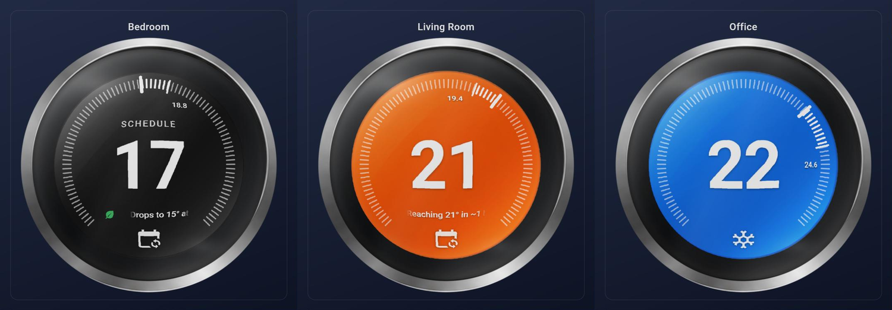
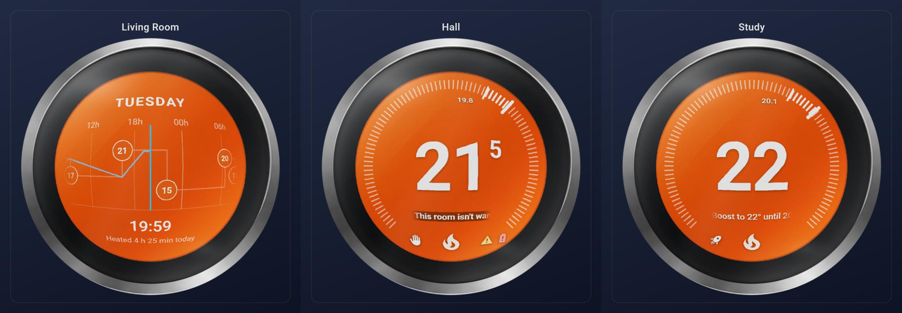

# Glass Dial Card

A round glass thermostat dial for Home Assistant. A flat coloured display sits behind a domed lens, in a black body with a
metal bezel. Drag the big number like a drum, flick through a weekly schedule, and see what your heating is doing at a
glance. It works with any `climate` entity.



## Features

- **Drum setpoint:** drag or flick the big number up and down; the neighbouring values only appear while you scroll
- **Colour tells the state:** orange while heating, blue while cooling, dark when idle
- **Weekly schedule:** tap the dial centre and scroll sideways through the week, with the room temperature drawn over it
- **Status ticker:** a small scrolling line for the next change, warm-up estimate, manual override, boost and warnings
- **Status icons:** manual, boost, heating warning, open window and low battery
- **Radiator valve glow, one-hold boost, haptic ticks, a visual editor**



## Install

### HACS (custom repository)

1. In HACS open the menu (⋮) → **Custom repositories**.
2. Add `https://github.com/M7URT/glass-dial-card` with the type **Dashboard**.
3. Install **Glass Dial Card**, then reload the page.

### Manual

1. Download `glass-dial-card.zip` from the latest release and unpack it into `/config/www/glass-dial-card/`, so the
   `glass-dial-card.js` file and the `img/` folder sit together.
2. Settings → Dashboards → ⋮ → Resources → add `/local/glass-dial-card/glass-dial-card.js` as a **JavaScript module**.

The card finds its images next to the script, so no image path is needed.

## Quick start

```yaml
type: custom:glass-dial-card
entity: climate.living_room
name: Living Room
```

Or use *Add card → Glass Dial Card* and the visual editor.

## Using the dial

| Gesture | Does |
|---|---|
| Drag or flick the big number up or down | Scrolls the setpoint like a drum; it is sent once it settles |
| Drag around the ring, arrow keys, mouse wheel (after clicking the dial) | Also change the setpoint |
| Tap the dial centre | Opens the weekly schedule (or the more-info pop-up if no schedule is set up) |
| Hold the dial centre | Opens the more-info pop-up |
| Tap the mode icon | Switches to the next HVAC mode |
| Hold the mode icon | Boost for an hour; hold again to cancel (needs `boost_timer`) |

In the schedule, drag sideways to scroll through the week; a flick keeps gliding. It closes on a tap or after 25 seconds.

## The ticker and badges

A small scrolling ticker under the number shows what applies right now, most important first:

- heating warning, open window, low battery
- boost running ("Boost to 24° until 15:30")
- manual override ("Manual · back to timed 17:23")
- warm-up estimate ("Reaching 21° in ~40 min")
- next scheduled change ("Warms to 21° at 17:00")

Short messages sit still; long ones scroll. Small icons beside the mode icon repeat the warnings, boost and manual state,
and a warm glow around the display shows the radiator valve opening.

The warm-up estimate is learned from the zone's last 36 hours of history: how fast the reported temperature rose in the
first half hour of recent heating runs. It follows what the thermostat *reports*, so a radiator valve that reads high
near its radiator will give short estimates.

## Options

| Option | Default | |
|---|---|---|
| `entity` | – | Required. A `climate` entity |
| `name` / `show_name` | friendly name / `true` | Title above the dial |
| `schedule_next`, `schedule_time` | – | The zone's "next setpoint" and "time to next setpoint" sensors. Enable the schedule and the "next change" message |
| `warning_entity` | – | A `binary_sensor` that is `on` when heating has a problem. Its `stalled_rooms` attribute (list of entity ids) is used if present |
| `window_entity` | – | Sensor whose state is not `closed`/`off` when a window is open |
| `valve_entity` | – | Valve position sensor, 0–100 |
| `boost_timer` | – | A `timer` entity; enables hold-to-boost |
| `boost_script` / `boost_delta` | `script.glass_dial_boost` / `2` | Script called by a boost, and degrees added |
| `manual_revert_hours` | `3` | Hours before a manual zone returns to timed (for the message). `0` hides the message |
| `tap_action` | `auto` | `auto`, `schedule`, `more-info` or `none` |
| `ticker`, `badges`, `haptics` | `true` | Turn features off |
| `style` | `face` | `face` (whole face coloured) or `ring` (black face, coloured arc) |
| `color_by` | `action` | `action` colours only while heating/cooling; `mode` colours by HVAC mode |
| `display_scale` | `0.78` | Size of the coloured display inside the black body |
| `bezel_inner`, `bezel_outer`, `dial_zoom` | `82.0`, `90.3`, `1.11` | Bezel ring trim and overall zoom |
| `fisheye` | `0.30` | Dome distortion of the display (0 = off) |
| `reflection`, `reflection_blur` | `1.2`, `4` | Glass highlights strength and blur (0 = off) |
| `glass_opacity`, `flatten`, `number_weight` | `0.18`, `0.55`, `600` | Glass tint, glare muting, weight of the big number |
| `eco_heat`, `eco_cool` | `18`, `24` | The leaf shows at or beyond these setpoints (or in the eco preset) |
| `step` | entity's step | Override the temperature step |
| `max_width` | `380px` | Maximum dial width |

Most of these can also be set in the visual editor.

## Home Assistant side

**Schedule.** Many thermostat integrations do not expose the weekly program. The card **learns it from the last 10 days
of history** of the two "next setpoint" sensors (each reading says "at now + N minutes the setpoint becomes X"), so it
works for any thermostat that provides them. Changes made in the thermostat's own app show up after a few days or the
12-hour refresh.

**Boost.** Hold-to-boost needs a timer per zone, a script and an automation: see [`examples/boost.yaml`](examples/boost.yaml).
The example is written for a thermostat where a manual mode is entered with `hvac_mode: heat`; adapt it to yours.

## Notes and limits

- Mouse-wheel changes only work after you have clicked the dial, so scrolling the page never changes a setpoint.
- A touch that starts on the number is a drag, so it will not scroll the page; start from the card edge to scroll.
- The dome effect uses a browser filter; very old browsers show a flat display instead.
- Tested in Chromium. Other browsers and phones are untested, so reports are welcome.

## Development

There is no build step: `dist/glass-dial-card.js` is the card. Open `dev/preview.html` through a local web server
(for example `python -m http.server` from the repository root, then `/dev/preview.html`) to see the card against
made-up thermostats.

## Licence and artwork

MIT, see [`LICENSE`](LICENSE). The dial artwork in `dist/img/` was generated with ChatGPT and is released under the same
licence. Copyright in AI-generated images varies between countries, so treat it as free to use rather than as protected.
